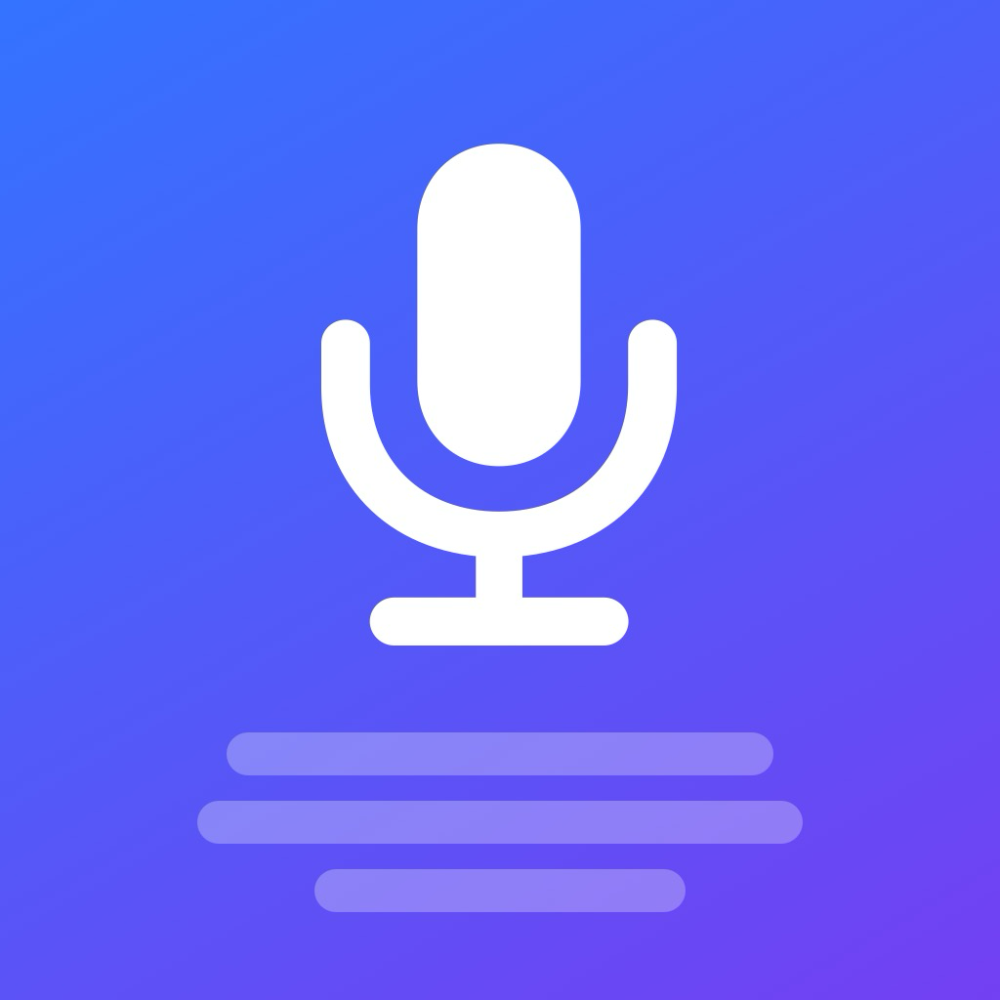

# マイ音声入力(MyVoice)

自分専用に作った、iPhone・iPad・Mac向けの音声入力です。話した言葉を [Groq](https://groq.com/) の Whisper で文字にして、カーソルの位置に入れます。

- **iPhone・iPad**: キーボードの中で録音します。アプリは切り替わりません
- **Mac**: Caps Lockを押している間だけ録音し、離すと前面のアプリに文字が入ります
- 用語辞書(固有名詞のヒントと置き換え)を、iPhoneとMacでiCloud同期します
- 「整える」「メール」「箇条書き」などの整形モードで、AIが話し言葉を文章に整えます

個人で使うために作った試作です。App Storeでは配っていません。自分のMacでビルドして使ってください。

## できること

| | iPhone・iPad(キーボード) | Mac(メニューバー) |
|---|---|---|
| 録音の始め方 | 「話す」ボタン | Caps Lock(F18)を押している間 |
| 録音中の表示 | ボタンの中に波形・秒数・マイク名 | 画面下にマイク名と波形 |
| マイクの選び方 | 「自動/本体」(AirPodsをつないでいても本体のマイクで録れる) | メニューで選ぶ(AirPodsに勝手に切り替わっても戻す) |
| 認識する言語 | 自動/日本語/英語 | 自動/日本語/英語 |
| 整形モード | キーボードの上の段で選ぶ | メニューで選ぶ |

- **用語辞書**: 上にある語ほど優先して、認識のヒントとしてGroqに送ります(Groqの `prompt` は224トークンまで)。実際に出た誤変換を登録すると、自動で置き換えます
- **AIのメモリから取り込む**: 依頼文をClaudeやChatGPTに貼ると、普段使っている固有名詞を辞書の形で返してくれます。その返事を貼ると、まとめて取り込めます
- **整形に失敗しても、話した言葉は失いません**。そのときは文字起こしをそのまま入れます

## 仕組み

```
録音(16kHz WAV) → Groq whisper-large-v3-turbo で文字起こし
              → 決まり文句(「ご視聴ありがとうございました」など)を捨てる
              → 用語辞書で置き換える
              → (整形モードなら)Groq qwen/qwen3.8-27b で整える
              → カーソルの位置に入れる
```

iPhoneのキーボードの中では、ふつうの方法ではマイクを使えません。そこで、見えない `WKWebView` の `getUserMedia` で録音しています。この部分は [stephancill/ios-keyboard-dictation](https://github.com/stephancill/ios-keyboard-dictation)(MIT)を元にしています。

> [!WARNING]
> この録音の方法は、将来のiOSで使えなくなる可能性があります。

## 必要なもの

- Xcode と [XcodeGen](https://github.com/yonaskolb/XcodeGen)(`brew install xcodegen`)
- Apple Developer Program のアカウント(iCloud同期とキーボードの共有Keychainに要ります)
- [Groq のAPIキー](https://console.groq.com/keys)(無料プランで使えます。カードの登録は要りません)

## ビルドの仕方

1. `project.yml` の `DEVELOPMENT_TEAM` を自分のチームIDに、`bundleIdPrefix` と `com.takasub5` で始まるIDを自分のものに書き換えます(`App/Info.plist` などの生成されるファイルは、次の手順で作り直されます)
2. プロジェクトを作ります

```bash
xcodegen generate
```

3. iPhoneに入れます(`<UDID>` は `xcrun devicectl list devices` で調べます)

```bash
xcodebuild -project MyVoice.xcodeproj -scheme MyVoice -destination 'id=<UDID>' -derivedDataPath build -allowProvisioningUpdates build
```

```bash
xcrun devicectl device install app --device <UDID> build/Build/Products/Debug-iphoneos/MyVoice.app
```

4. Mac版を入れます

```bash
xcodebuild -project MyVoice.xcodeproj -scheme MyVoiceMac -destination 'platform=macOS' -derivedDataPath build -allowProvisioningUpdates build
```

```bash
ditto "build/Build/Products/Debug/マイ音声入力.app" "/Applications/マイ音声入力.app"
```

## 使う前の設定

**iPhone**
1. アプリを開いてマイクを許可し、GroqのAPIキーを保存します
2. 設定 → 一般 → キーボード → キーボード → 新しいキーボードを追加 → マイ音声入力 → 「フルアクセスを許可」をオンにします

**Mac**
1. メニューバーのマイクのアイコン → 「設定…」で、GroqのAPIキーを保存します
2. マイクとアクセシビリティ(カーソル位置に貼り付けるため)を許可します
3. Caps Lockで録音したい場合は、[Karabiner-Elements](https://karabiner-elements.pqrs.org/) で Caps Lock を F18 に変えます

## 料金の目安

Groqの `whisper-large-v3-turbo` は $0.04/時間で、1回は最低10秒として数えられます。無料プランの上限(1日2,000回、音声8時間分など)の中なら0円です。アプリの「今月の使用量」には、有料だった場合の目安を出しています。

## ライセンス

[MIT](LICENSE)。録音部分(`Keyboard/WebAudioCapture.swift`)は stephancill/ios-keyboard-dictation のMITライセンスです([Keyboard/WebAudioCapture-LICENSE.txt](Keyboard/WebAudioCapture-LICENSE.txt))。
